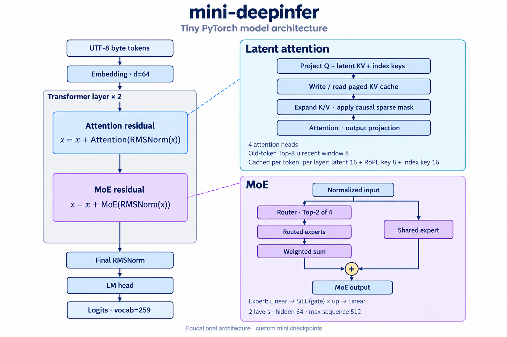

# mini-deepinfer

[](https://github.com/pjgao/mini-deepinfer/actions/workflows/ci.yml)
[English](README.en.md) · [源码导读](docs/walkthrough.md) · [设计对照](docs/upstream-map.md) · [环境配置](docs/environment.md)

mini-deepinfer 是一个用 PyTorch 编写的小型语言模型推理引擎，用于学习模型计算、KV 缓存和请求调度。
项目参考 [DeepInfer](https://github.com/deepseek-ai/DeepInfer) 的设计，
采用 [nano-vllm](https://github.com/GeeeekExplorer/nano-vllm) 和
[mini-sglang](https://github.com/sgl-project/mini-sglang) 这类教学项目的小型代码结构，
独立实现了压缩 KV、稀疏注意力、MoE、连续批处理和推测解码。

项目包含模型、推理引擎、训练示例和测试，可以直接在 CPU 上运行，无需下载模型权重或编译自定义算子。
适合熟悉 Python 和基本 PyTorch 用法、希望阅读或修改推理引擎源码的读者。
默认模型使用随机权重；也可以用仓库内的训练脚本生成自己的小模型权重。

## 功能

| 模块 | 功能 |
|---|---|
| 模型 | 压缩 latent KV、独立的 RoPE key、基于索引与滑动窗口的因果稀疏注意力 |
| MoE | 每个 token 选择 Top-K 路由专家，同时经过一个共享专家 |
| KV 缓存 | 分页存储、逻辑页到物理页的映射、引用计数与回收 |
| 前缀复用 | 按 token 序列匹配完整缓存页，使用 LRU 回收；未填满的尾页由请求独占 |
| 请求调度 | 连续批处理、分块预填充、每步 token 数量限制，以及请求添加和取消 |
| 推测解码 | 从 n-gram 生成草稿，按置信度分配草稿预算，由目标模型验证并在拒绝后回退 |
| 采样 | 贪心采样、温度采样、Top-K 采样和每个请求独立的随机数生成器 |
| 训练与保存 | 小模型训练、权重保存与加载、命令行和 Python 接口 |

推测解码目前只支持贪心采样。运行时采用单进程、单设备的同步执行方式，核心计算均使用 PyTorch 算子。

## 快速开始

先安装 [uv](https://docs.astral.sh/uv/getting-started/installation/)。
项目默认使用 Python 3.12，兼容 Python 3.10+；以下命令会创建虚拟环境，并根据 `uv.lock` 安装 CPU 依赖：

```bash
git clone https://github.com/pjgao/mini-deepinfer.git
cd mini-deepinfer
uv sync --locked

uv run mini-deepinfer --device cpu --max-tokens 8
uv run python examples/trace_scheduler.py
uv run pytest -q
```

`mini-deepinfer` 命令输出每个请求生成的 token ID、文本、结束原因和引擎统计。
随机权重通常会生成无意义文本，这是默认示例的正常现象。需要观察文本续写时，可运行下文的训练示例。

`trace_scheduler.py` 按步打印调度结果，包括正在处理的请求、预填充或解码阶段、空闲页数和前缀缓存命中数。
它适合用来观察请求加入、完成以及缓存复用的过程。

uv 命令无需手动激活虚拟环境。Windows 原生 PyTorch 若遇到 DLL 加载问题，也可使用 WSL2。
Python 版本选择、依赖更新及设备环境安装方法见 [环境配置](docs/environment.md)。

## Python 接口

`LLM.generate()` 接收一组输入和采样参数，返回每个请求的生成结果。
`token_budget` 限制每个调度步处理的 token 数，`prefill_chunk` 控制单次预填充的分块大小：

```python
from mini_deepinfer import LLM, SamplingParams

with LLM(device="cpu", token_budget=32, prefill_chunk=16) as llm:
    outputs = llm.generate(
        ["What is a KV cache?", "What is a routed expert?"],
        SamplingParams(max_tokens=16, temperature=0),
    )
    print(outputs[0].token_ids)
    print(llm.stats)
```

如果需要逐步控制调度，可以使用 `add_request()` 添加请求、`step()` 执行一步计算，
并通过 `cancel()` 取消请求。`llm.stats` 记录预填充、解码、输出 token 数，以及前缀复用和草稿接受情况。

## 模型与执行流程



默认模型有 2 层、64 维隐藏状态和 4 个注意力头。每层包含 4 个路由专家，
每个 token 选择其中 2 个，另有一个共享专家。分词器按 UTF-8 字节编码，
词表包含 256 个字节值和 BOS、EOS、PAD 三个特殊 token。
默认上下文上限为 512 token，计入输入和生成长度。配置定义在
[`ModelConfig`](mini_deepinfer/config.py) 中。

每层为每个 token 缓存 16 维 KV latent、8 维 RoPE key 和 16 维索引 key。
注意力计算时展开 K/V，取单头索引器评分最高的 Top-K 历史位置与最近滑动窗口的并集。
MoE 则将 token 分发给选中的专家，再合并专家输出。

引擎先为请求预留输入与最大生成长度所需的缓存页，再安排预填充或解码。
同一步内，不同请求的 token 会合并执行投影和 MoE，注意力计算按请求分别处理。
生成遇到 EOS 或达到长度限制后，引擎结束请求并释放其页引用；可复用的完整前缀页继续保留。
同一批次可以同时包含预填充和解码请求，下图中的完成判断分别针对每个请求。



[Mermaid 源文件](docs/assets/scheduler.mmd)

[源码导读](docs/walkthrough.md) 介绍了具体的调度状态、缓存变化和阅读练习。
[设计对照](docs/upstream-map.md) 列出了各模块参考的 DeepInfer 实现。

## 训练一个小模型

训练脚本使用仓库内的合成文本，演示前向计算、反向传播、保存权重和加载后生成：

```bash
uv run python examples/train_tiny.py --steps 160 --output checkpoints/tiny
uv run mini-deepinfer --checkpoint checkpoints/tiny --prompt "A KV cache" --max-tokens 40
uv run mini-deepinfer --checkpoint checkpoints/tiny --prompt "A KV cache" --max-tokens 40 --draft-tokens 3
```

这组练习可以用来观察损失变化、文本续写和草稿接受率。训练文本很少，结果主要反映对这些文本的拟合。

训练默认使用稠密因果注意力。稀疏索引中的硬 Top-K 选择需要额外的训练目标，
本项目尚未实现 DeepSeek 的索引器训练方法。默认随机模型仍可用于检查稀疏注意力与缓存计算是否一致。

## 性能测量

使用同一份权重，分别运行普通解码和推测解码：

```bash
uv run python examples/benchmark.py --checkpoint checkpoints/tiny --output runs/baseline.json
uv run python examples/benchmark.py --checkpoint checkpoints/tiny --draft-tokens 3 --output runs/spec.json
```

结果以 JSON 保存，包含总耗时、实际输出 token 数、每秒输出 token 数、
草稿提出数、接受数和接受比例。计时覆盖预填充、调度、模型计算和采样，
并在测量开始和结束时同步设备。

这个实现保留了较多 Python 控制流、缓存 gather 和稳定排序，重点是便于阅读。
草稿验证也有开销，推测解码可能更慢。比较不同配置时，应固定权重、请求、设备、
线程数、上下文长度和缓存条件，并交替运行多轮。

## 设备支持

| 设备 | 运行方式 | 验证情况 |
|---|---|---|
| CPU | 默认 uv 环境 | 已通过单元测试、生成、训练和缓存一致性检查 |
| CUDA | 使用适合设备的 PyTorch，通过 `device="cuda:0"` 选择 | 提供运行接口，尚未进行设备实测 |
| Ascend NPU | 使用匹配的 `torch`、`torch_npu`、驱动和 CANN | 提供运行接口，尚未进行设备实测 |

详细环境与结果见 [验证记录](docs/validation.md)。不同设备之间的数值和输出一致性需要分别测试。

在已有 NPU 环境中，可以只安装本项目，再运行设备检查：

```bash
uv pip install --python /path/to/npu-env/bin/python -e . --no-deps
# 先确认设备归属和空闲情况；示例中的 0 是已获准使用的可见设备。
ASCEND_RT_VISIBLE_DEVICES=0 /path/to/npu-env/bin/python examples/validate_device.py --device npu:0 --output runs/npu.json
```

将解释器路径替换为实际 NPU 环境路径，设备编号按机器分配设置。
该环境应保留原有的 PyTorch 与 torch_npu 配对，不要用默认 CPU 配置的 `uv sync` 覆盖它，
也无需为本项目升级共享机器的驱动。检查脚本使用 PyTorch eager 执行小模型。
更多信息见 [昇腾说明](docs/ascend.md)。

## 实现范围

mini-deepinfer 使用自己的模型结构、分词器和权重格式，不支持官方 DeepSeek-V4.1 权重，
也不依赖完整 DeepInfer。它是独立的教学项目，与 DeepSeek 官方无隶属关系。

模型简化了稀疏索引器，并在读取缓存时展开 K/V。尚未实现吸收矩阵、V4.1 特有的压缩方案、
YOCO 或跨层缓存共享、KV 量化，以及 DSpark 的训练草稿头。
分页管理会预留请求所需的最大容量，不支持抢占；前缀缓存按完整 token 页匹配，不使用 radix tree。

引擎也未实现分布式 TP/EP/CP、EPLB、MegaMoE、CPU 与设备异步重叠、图捕获、
融合或厂商专用算子、结构化输出约束和在线 API 服务。
这里的稀疏注意力用于展示算法与缓存的关系，未针对稀疏 kernel 做性能优化。
本项目用于源码学习和小规模实验；性能脚本用于比较本项目内的配置，不代表生产推理服务的性能。

## 源码导航

建议先阅读模型的全序列计算，再看缓存和调度如何接入：

| 文件 | 阅读内容 |
|---|---|
| [`config.py`](mini_deepinfer/config.py) | 模型配置与采样参数 |
| [`model.py`](mini_deepinfer/model.py) | 无缓存 `forward()`、分页 `forward_batch()`、注意力和 MoE |
| [`cache.py`](mini_deepinfer/cache.py) | 页分配、引用计数、前缀共享与回收 |
| [`engine.py`](mini_deepinfer/engine.py) | `add_request → step → _emit → _finish` 的请求处理过程 |
| [`speculative.py`](mini_deepinfer/speculative.py) | 草稿生成、预算分配、验证与回退 |
| [`tests/`](tests/) | 各项功能的测试和数值对照 |

## 测试与贡献

```bash
uv run ruff check .
uv run pytest -q
uv run python examples/validate_device.py --device cpu
uv build
```

测试将分页、分块计算的 logits 与无缓存的全序列结果对照，
覆盖因果性、请求隔离、前缀共享、缓存容量不足、取消、EOS、随机采样，
以及草稿接受或拒绝后的输出一致性。GitHub Actions 运行 CPU 测试，CUDA/NPU 需在对应设备上测试。

欢迎改进代码可读性、补充示例和测试。涉及优化时，请同时给出正确性对照和测量条件；
较大的分布式或专用算子扩展，可以先通过 issue 讨论。参见 [贡献指南](CONTRIBUTING.md)。

## 参考与许可

- [DeepInfer](https://github.com/deepseek-ai/DeepInfer)：模型执行与引擎设计。
- [nano-vllm](https://github.com/GeeeekExplorer/nano-vllm)：小型推理引擎的代码组织。
- [mini-sglang](https://github.com/sgl-project/mini-sglang)：教学推理系统的功能划分与调度组织。

参考项目的固定版本记录在 [provenance.json](provenance.json) 中。
本项目代码独立编写，采用 Apache-2.0 许可证。详见 [LICENSE](LICENSE) 和 [NOTICE](NOTICE)。
