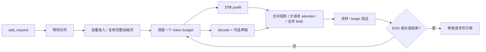

# mini-deepinfer

[](https://github.com/pjgao/mini-deepinfer/actions/workflows/ci.yml)
[English](README.en.md) · [源码导读](docs/walkthrough.md) · [上游映射](docs/upstream-map.md) · [昇腾验证](docs/ascend.md)

**用一个能在 CPU 上运行的小引擎，读懂 DeepInfer 中模型、KV cache、调度与推测解码如何配合。**

参考 [nano-vllm](https://github.com/GeeeekExplorer/nano-vllm) 与
[mini-sglang](https://github.com/sgl-project/mini-sglang) 的小型、可读项目组织方式，
依据 [DeepInfer](https://github.com/deepseek-ai/DeepInfer) 的设计重新实现。所有核心计算使用普通 PyTorch，
无需下载模型即可运行；没有依赖完整 DeepInfer，也没有将它包装成一个黑盒。

> **范围：这是一个独立的教学实现。** 默认模型是随机初始化的小模型，不会正常聊天。
> 可以训练并加载本项目自己的小 checkpoint，但**不支持官方 DeepSeek-V4.1 权重**。
> 模型借鉴压缩 KV、稀疏索引和 MoE，未复刻完整 V4.1 结构。
> CUDA/NPU 提供 eager 执行入口；已验证的平台见 [验证记录](docs/validation.md)。
> 本项目不是 DeepSeek 官方项目，不提供生产性能或跨设备逐位一致的承诺。

## 五分钟运行

先安装 [uv](https://docs.astral.sh/uv/getting-started/installation/)。项目默认使用 Python 3.12，
仍兼容 Python 3.10+；uv 会创建环境并按 `uv.lock` 安装 CPU 依赖：

```bash
git clone https://github.com/pjgao/mini-deepinfer.git
cd mini-deepinfer
uv sync --locked

uv run mini-deepinfer --device cpu --max-tokens 8
uv run python examples/trace_scheduler.py
uv run pytest -q
```

默认输出包括生成 token ID、文本和计数。随机模型的文本没有语义；**能生成 token 不是模型质量证明**。
Windows 原生 PyTorch 若出现 DLL 环境问题，可在 WSL2 中执行相同命令。
无需手动激活虚拟环境。依赖更新、Python 版本选择及 CUDA/NPU 环境见
[uv 环境说明](docs/environment.md)。

```python
from mini_deepinfer import LLM, SamplingParams

with LLM(device="cpu", token_budget=32, prefill_chunk=16) as llm:
    outputs = llm.generate(
        ["What is a KV cache?", "What is a routed expert?"],
        SamplingParams(max_tokens=16, temperature=0),
    )
    print(outputs[0].token_ids)
    print(llm.stats)
```

## 实际实现了什么

| 能力 | 实现 | 有意保留的边界 |
|---|---|---|
| 压缩 latent KV | 缓存低维 latent、独立 RoPE key 与 index key | 读取时展开 K/V，未实现吸收矩阵与融合 kernel |
| 稀疏注意力 | 历史索引 Top-K 与滑动窗口取并集，严格因果 | 单头简化 indexer；不含 V4.1 压缩、YOCO、跨层共享 |
| MoE | 每 token Top-K 路由 + 一个共享专家，实际 dispatch/combine | 单设备，不含 EP、EPLB、MegaMoE |
| 分页 KV | 逻辑页到物理页映射、引用计数、释放 | 准入时预留最坏容量，不做抢占 |
| 前缀缓存 | 完整页共享、精确 token key、可回收 LRU | 尾页私有；不是 radix tree 或分布式 KV 系统 |
| 调度 | token budget、chunked prefill、连续批处理 | 同步调度；没有 CPU/设备 overlap 或图捕获 |
| 推测解码 | n-gram 草稿、共享置信度预算、target 验证和回退 | **仅 greedy**；不是 DSpark 的训练草稿头 |
| 采样 | greedy、temperature、Top-K、每请求 RNG | 无 grammar/JSON schema 约束 |
| 小模型训练 | 完整前向、反向、checkpoint 保存/加载 | 合成语料练习，不是官方模型训练配方 |

批处理不是循环调用多个独立引擎：投影与 MoE 在合并后的 token 张量上执行；
注意力按请求切片，便于阅读不同长度请求的边界。调度器支持运行中 `add_request()` 和 `cancel()`。



## 从随机模型走到可观察的小模型

下面只拟合仓库内的一小段合成文本，适合观察损失、缓存与推测接受率，不能用于评价语言能力：

```bash
uv run python examples/train_tiny.py --steps 160 --output checkpoints/tiny
uv run mini-deepinfer --checkpoint checkpoints/tiny --prompt "A KV cache" --max-tokens 40
uv run mini-deepinfer --checkpoint checkpoints/tiny --prompt "A KV cache" --max-tokens 40 --draft-tokens 3
```

训练示例默认关闭稀疏选择：硬 Top-K 的索引不会自动获得有效训练梯度。本项目没有实现
DeepSeek 的 indexer 训练目标。默认随机模型仍可用于验证稀疏执行链的数值一致性。

## 性能实验的正确口径

```bash
uv run python examples/benchmark.py --checkpoint checkpoints/tiny --output runs/baseline.json
uv run python examples/benchmark.py --checkpoint checkpoints/tiny --draft-tokens 3 --output runs/spec.json
```

统计的是**实际发出的 token 数 / 总时间**，包括 prefill、调度与采样；设备计时前后显式同步，
并单独报告草稿提出数、接受数、接受比例。没有把最大草稿长度当作输出长度。
这个参考实现可能因为 Python 控制流、同步、缓存 gather 和稳定排序变慢；推测解码也不保证提速。
比较时请保持权重、请求、设备、线程、上下文和缓存条件相同，多次交替运行。

## 推荐阅读顺序

1. [`config.py`](mini_deepinfer/config.py)：模型与请求参数。
2. [`model.py`](mini_deepinfer/model.py)：先看无缓存 `forward()`，再看分页 `forward_batch()`。
3. [`cache.py`](mini_deepinfer/cache.py)：完整页共享和物理地址映射。
4. [`engine.py`](mini_deepinfer/engine.py)：`add_request → step → _emit → _finish`。
5. [`speculative.py`](mini_deepinfer/speculative.py)：草稿分配、验证与逻辑回退。
6. [`tests/`](tests/)：对照每个机制的独立正确性信号。

[源码导读](docs/walkthrough.md) 包含具体状态推演和实验练习；
[上游映射](docs/upstream-map.md) 说明各模块对应的 DeepInfer 路径与简化边界。

## 昇腾

在已有匹配的 `torch`、`torch_npu`、驱动和 CANN 环境中：

```bash
uv pip install --python /path/to/npu-env/bin/python -e . --no-deps
# 先确认设备归属和空闲情况；示例中的 0 是已获准使用的可见设备。
ASCEND_RT_VISIBLE_DEVICES=0 /path/to/npu-env/bin/python examples/validate_device.py --device npu:0 --output runs/npu.json
```

这里验证的是 PyTorch eager 小模型路径，**不是 DeepInfer 的 Ascend 950 厂商算子栈**。
将上面的解释器路径替换为已有 NPU 环境的实际路径；在该环境中不要运行默认 CPU 配置的 `uv sync`。
不要为运行这个教学项目升级共享机器的驱动或覆盖生产环境。详见 [昇腾适配说明](docs/ascend.md)。

## 测试与贡献

```bash
uv run ruff check .
uv run pytest -q
uv run python examples/validate_device.py --device cpu
uv build
```

测试将分页/分块 logits 与无缓存全序列计算对齐，并覆盖因果性、请求隔离、共享前缀、
内存压力、取消、EOS、随机采样，以及接受/拒绝草稿后的完整输出一致性。
默认 CI 只验证 CPU；CUDA/NPU 需要设备实测，不能从 CPU 绿灯推导。

欢迎提交能让执行链更清晰、测试更可靠的改动。优化必须附带正确性对照；
较大的分布式和厂商 kernel 实现应先讨论教学范围。见 [CONTRIBUTING.md](CONTRIBUTING.md)。

## 参考与许可

- [DeepInfer](https://github.com/deepseek-ai/DeepInfer)：模型执行与引擎设计参考，固定版本见 [provenance.json](provenance.json)。
- [nano-vllm](https://github.com/GeeeekExplorer/nano-vllm)：小型推理引擎的组织与阅读方式。
- [mini-sglang](https://github.com/sgl-project/mini-sglang)：教学系统的功能分层与调度组织。

独立编写的教学代码，Apache-2.0。参见 [LICENSE](LICENSE) 和 [NOTICE](NOTICE)。
